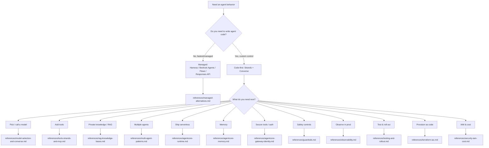

# Decision tree (visual)

Mermaid rendering of the `SKILL.md` router. Illustrative — see `SKILL.md` and the `references/`
files for the authoritative, cited detail.

Sources: this diagram is a restatement of `SKILL.md`, which cites its underlying AWS/Strands docs.
